<!-- =====================================================
     CHATHUKA PEHESARA | GITHUB PROFILE
     Minimal · Modern · Developer-focused
====================================================== -->

<!-- ================= HERO SECTION ================= -->

 

&nbsp;

&nbsp;

  

<!-- ================= END HERO ================= -->

---

## 01 / About Me

I'm **Chathuka Pehesara**, an undergraduate specializing in Artificial Intelligence at the Sri Lanka Institute of Information Technology (SLIIT).

I enjoy working at the intersection of software engineering and artificial intelligence — turning technical ideas into practical applications.

- Currently building full-stack applications and AI-powered systems.
- Exploring machine learning, generative AI and cloud infrastructure.
- Interested in scalable backend architectures and thoughtful UI/UX.
- Always learning, experimenting and building something new.

> Code with purpose. Design with empathy.

---

## 02 / Technology Stack

**Languages**

  

**Frontend & Backend**

  

**AI / Machine Learning**

  

**Database, Cloud & Tools**

  

---

## 03 / Selected Projects

A few things I've been working on.

<table>
<tr>
<td width="50%" valign="top">

### 🧠 AI Customer Support Platform

Multi-tenant AI customer support system using retrieval-augmented generation and vector search.

**Technologies**

`FastAPI` `LangChain` `OpenAI` `Pinecone`

</td>
<td width="50%" valign="top">

### 🐍 Snake Venom Classifier

An AI-based snake identification system combining image classification and an accessible species information platform.

**Technologies**

`Python` `TensorFlow` `FastAPI` `PWA`

</td>
</tr>
<tr>
<td width="50%" valign="top">

### ⚡ Tariff Bill Forecaster

A machine-learning-powered electricity bill forecasting application designed around Sri Lankan domestic electricity tariffs.

**Technologies**

`Python` `FastAPI` `Next.js` `Machine Learning`

</td>
<td width="50%" valign="top">

### 🌱 Tea Plantation Management

A full-stack plantation management platform integrating resource management, tea leaf disease detection and price prediction.

**Technologies**

`Spring Boot` `React` `PostgreSQL` `CNN`

</td>
</tr>
</table>

---

## 04 / GitHub Activity

  

---

## 05 / Beyond the Code

I believe good software is more than functionality. It's about solving real problems, understanding people and creating experiences that make technology useful.

Currently exploring:

- Generative AI and intelligent agents
- Cloud-native application development
- Applied machine learning
- Software architecture and engineering practices

---

### Let's Build Something Meaningful.

Open to interesting collaborations, engineering discussions and opportunities to build impactful products.

 

  

Designed with purpose · Built with curiosity · <b>CP ⬡</b>

